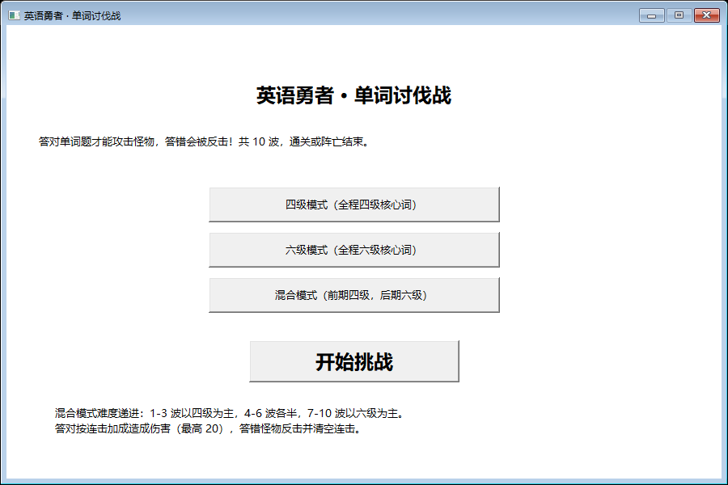
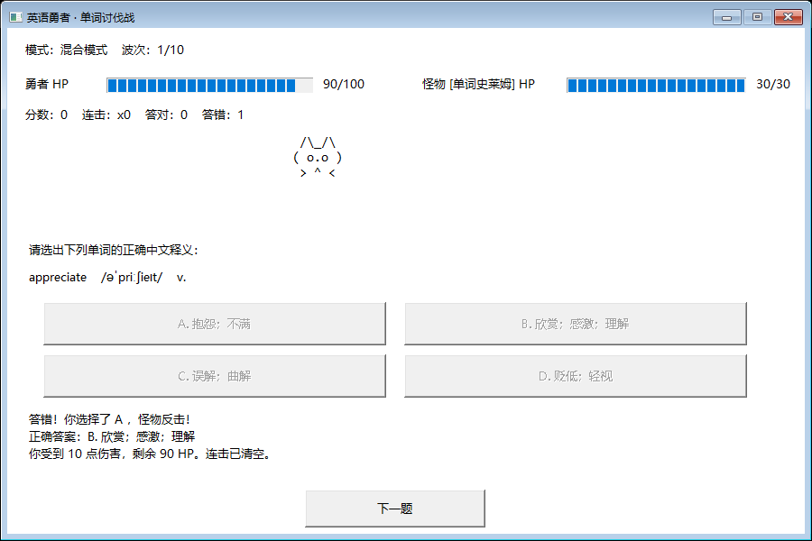

# 英语勇者 · 单词讨伐战（Vocab Hero）

一个基于 Win32 API 的图形界面英语单词闯关游戏。答对四/六级单词题才能攻击怪物，答错会被反击；连续击败 10 波怪物即可通关。



## 游戏特色

- **三种模式**：四级模式、六级模式、混合模式（前期四级、后期六级，难度递进）
- **内置词库**：四级、六级核心词各 50 条，含音标、词性与三个干扰项
- **战斗系统**：勇者 100 HP，怪物血量随波次从 30 递增到 102；答对按连击加成造成伤害（最高 20），答错怪物反击并清空连击
- **计分统计**：答对得分 + 连击加成 + 通关奖励，实时显示分数、连击、答对/答错数
- **原生窗口**：真正的 Win32 图形界面（按钮、双血条、ASCII 怪物画像），不依赖命令行窗口或第三方运行库



## 目录结构

```
VocabHero/
├── README.md                    # 本说明
├── VocabHero_Setup.exe          # 自解压安装包（双击安装，含桌面/开始菜单快捷方式）
├── bin/
│   └── VocabHero.exe            # 图形界面主程序（可直接双击运行）
├── src/
│   ├── VocabHeroGUI.cpp         # 游戏完整源码（C++17 / Win32 API）
│   ├── installer.cpp            # 安装器源码
│   └── package.sed              # IExpress 打包配置
└── docs/
    └── screenshots/             # 界面截图
```

## 运行方式

**方式一：直接运行**

双击 `bin/VocabHero.exe` 即可开始游戏，无需安装。

**方式二：安装到本机**

双击 `VocabHero_Setup.exe`，程序会安装到 `%LOCALAPPDATA%\Programs\VocabHero`，并创建桌面与开始菜单快捷方式；卸载入口位于开始菜单和“设置 → 应用”。

## 操作说明

1. 在开始界面选择模式，点击「开始挑战」
2. 阅读题目，点击 `A` / `B` / `C` / `D` 按钮作答
3. 查看命中/反击反馈与正确答案，点击「下一题」继续
4. 击败怪物进入下一波；血量归零或通关后进入结算界面
5. 结算界面可点击「重新开始」或「退出」

## 编译源码

**Windows（Visual Studio / MSVC）**

```bat
call "%VCINSTALLDIR%\Auxiliary\Build\vcvars64.bat"
cl /EHsc /std:c++17 /O2 /utf-8 /MT /nologo src/VocabHeroGUI.cpp comctl32.lib user32.lib gdi32.lib /Fe:VocabHero.exe /link /SUBSYSTEM:WINDOWS
```

**Windows（MinGW-w64 / g++）**

```bash
g++ -std=c++17 -O2 -municode -mwindows -static src/VocabHeroGUI.cpp -lcomctl32 -o VocabHero.exe
```

> 源码使用 UTF-8 编码。MSVC 需 `/utf-8`，MinGW 可用 `-fexec-charset=UTF-8`。

## 许可

仅供学习与娱乐使用。
